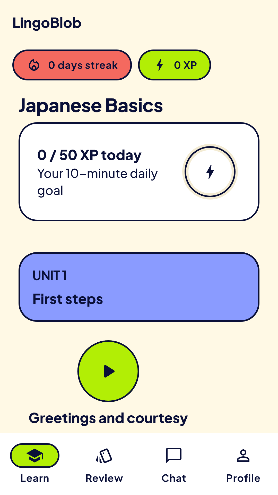
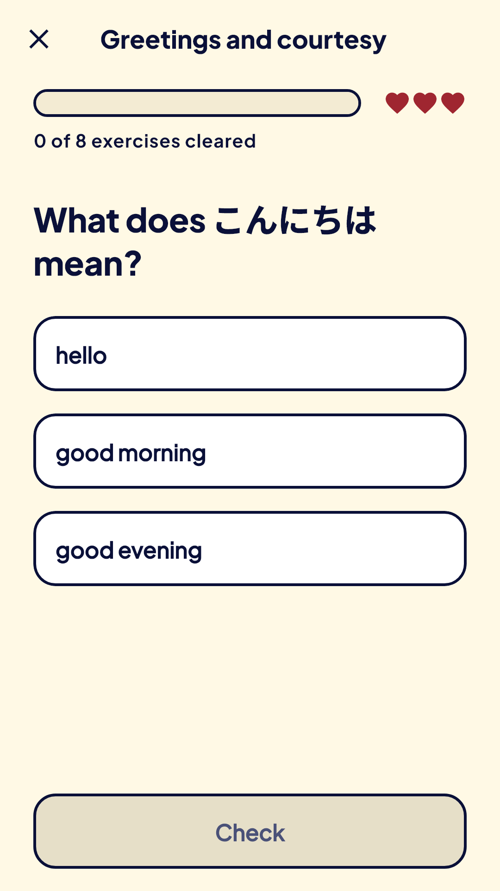
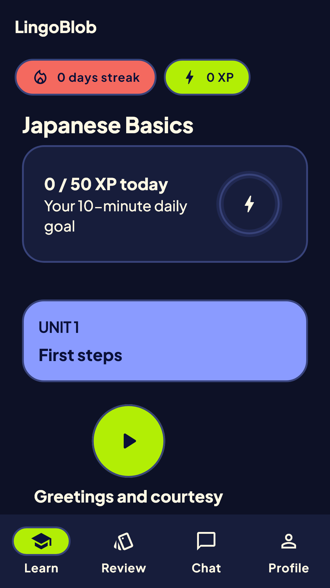
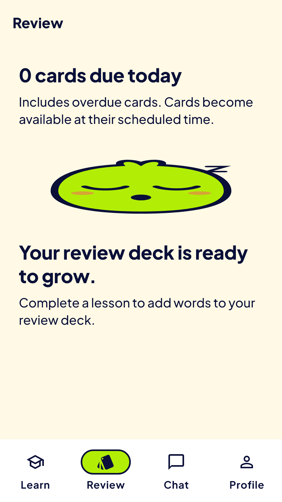
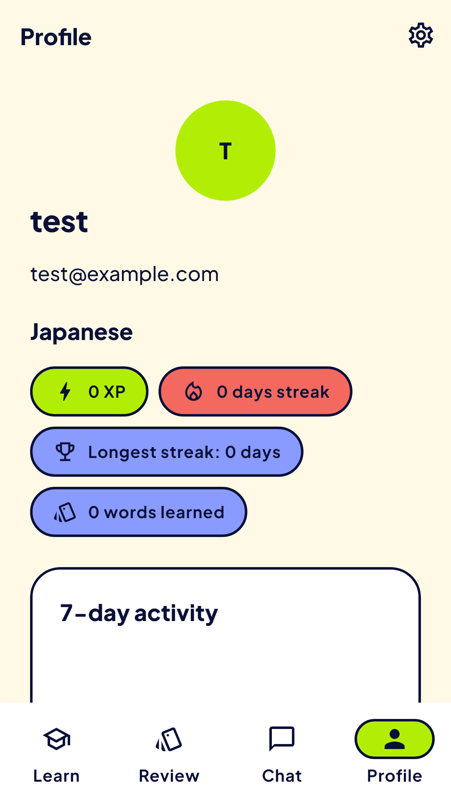
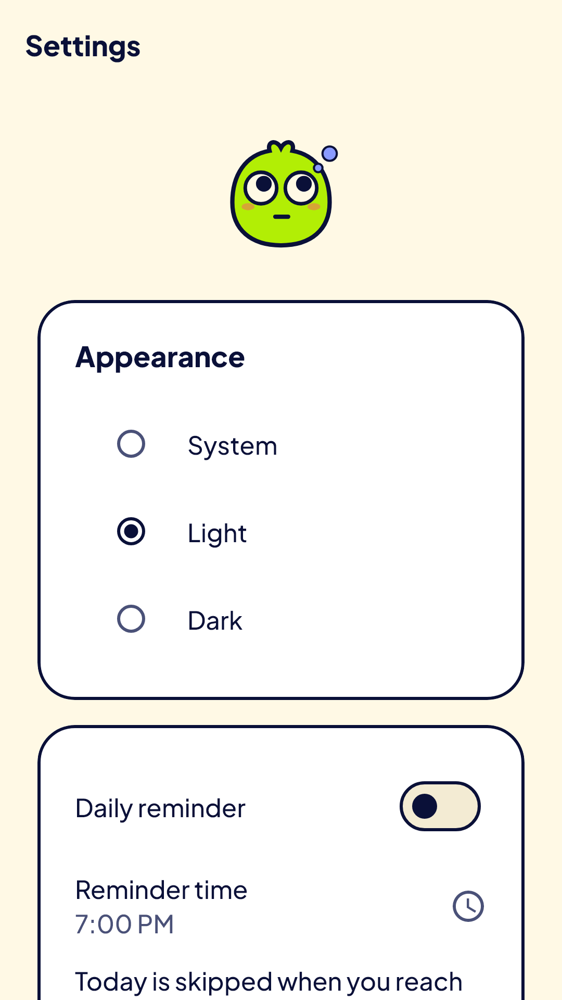

# LingoBlob

Beginner Japanese, Spanish, French, German, Italian and Brazilian Portuguese for
English speakers, built with Flutter and Pip the mascot.
Lessons, spaced repetition and optional speaking practice share a local SQLite
database. Supabase handles accounts/sync; Groq runs behind an authenticated Edge
Function for conversation practice.

## Screenshots

| Learn | Lesson | Dark mode |
| --- | --- | --- |
|  |  |  |

| Review | Profile | Settings |
| --- | --- | --- |
|  |  |  |

These are real app widget renders with isolated test data. Additional login and
Chat captures are in [docs/screenshots](docs/screenshots). Regenerate the
1080x1920 images with `flutter test test/support/capture_lingoblob.dart`.

## Features

- Six bundled beginner courses: 360 words/phrases, 36 lessons and 288 exercises.
- Data-driven onboarding, course switching in Settings and a daily study goal.
- Six exercise types: choice, matching, fill-in-the-blank, translation, listening
  and speaking; hearts, feedback, results and sequential lesson unlocks.
- SM-2 flashcards, pronunciation playback, audio caching and TTS fallback.
- Local-calendar streaks, daily XP, seven-day activity charts and opt-in reminders.
- Email/password and Google sign-in, confirmation and password recovery links.
- Local-first progress with owned cloud rows and timestamp/revision-based sync.
- Four AI scenarios, corrections, tap-to-translate, dictation, saved suggested
  words, retries and the last 20 messages stored locally per account, filtered by
  course and scenario. The selected course also sets the tutor language.
- Material 3 light/dark/system themes, bundled Plus Jakarta Sans, screen-reader
  labels, large-font layouts and reduced-motion-aware page transitions.

AI replies require the deployed backend and server Groq secret. Initial account
setup needs internet; cached accounts can study offline. Speech availability and
offline recognition depend on the device/provider. English is currently the only
interface locale; UI copy lives in ARB.

Choose **Settings → Learning language** to change courses. Completed lessons and
flashcards stay in their original course; XP, streaks and your daily goal remain
account-wide. Portuguese pronunciation uses `pt-BR`. Each course contains two
units, six lessons, 60 vocabulary entries and all six exercise types.

See [multilingual course setup and changed files](MULTILINGUAL_COURSES.md) for the
curriculum sources, validation, testing and the required chat-function redeploy.

## Architecture

```text
Flutter widgets (presentation) <---- go_router navigation and auth redirects
             |
Riverpod controllers/providers
             |
Pure Dart domain: grading, SM-2, streaks, speech similarity
             |
Repositories ---- Drift SQLite (source of truth, isolated per account)
      |                         |
Course JSON                Background SyncService
                                |
                       Supabase Auth + Postgres/RLS

ChatApi -> authenticated Supabase Edge Function -> Groq (server-only key)
AudioService -> bundled/cached recording -> TTS fallback
SpeechService -> device recognition -> editable transcript
```

```text
lib/core/                         config, database, router, theme, localization
lib/features/<feature>/data/       repositories, persistence, platform adapters
lib/features/<feature>/domain/     models and pure algorithms
lib/features/<feature>/presentation/ controllers and small widgets
lib/shared/widgets/               shared UI and Pip
assets/courses/                   bundled curriculum
supabase/                         migrations, RLS, sync RPCs, chat function
test/                            unit, widget, HTTP and migration tests
integration_test/                 device lesson/persistence flow
```

A Riverpod provider supplies subscribed state/dependencies, similar to React
context with a state store. Drift is the typed SQLite layer. Widgets render
state; grading, sync and database changes stay outside widgets.

## Setup

Use Flutter stable and the Dart SDK required by `pubspec.yaml`. Verified locally
with Flutter 3.47.6 / Dart 3.13.5. Android builds need Android Studio, API 37 and
a compatible JDK.

In Android Studio's SDK Manager, install **Android SDK Command-line Tools
(latest)** under SDK Tools. Flutter's release-bundle validation needs the included
`apkanalyzer` tool.

```powershell
cd C:\Langunge_flutter\myapp
flutter doctor -v
flutter pub get
Copy-Item config.example.json config.local.json
```

Fill your public Supabase URL/key in the ignored `config.local.json`. Never put a
service-role key, Groq key or signing password in Flutter. Generate the ignored
fallback asset for plain IDE launches:

```powershell
python tool/prepare_local_config.py
```

Run SQL migrations in filename order. Follow [Supabase setup](SUPABASE_SETUP.md),
[Phase 7 additions](PHASE7_IMPLEMENTATION.md) and
[Groq deployment](PHASE9_IMPLEMENTATION.md). Keep
`io.languagelearning.app://auth-callback` in Supabase's redirect allowlist.

Android:

```powershell
flutter emulators
flutter emulators --launch Medium_Phone_API_37.0
flutter devices
flutter run -d emulator-5554 --dart-define-from-file=config.local.json
```

Browser (keep a fixed port to preserve browser SQLite storage):

```powershell
flutter run -d edge --web-port=7357 --dart-define-from-file=config.local.json
```

The Android ID is `com.charlie22dev.lingoblob`; it installs separately from old
`com.example.myapp` test builds. iOS IDs match but require Xcode signing/testing
on a Mac. If using an Android-specific Google OAuth client, update its package
ID and certificate fingerprints. The existing OAuth callback scheme is unchanged.

## Tests and performance

```powershell
flutter analyze
flutter test
node --experimental-strip-types --test supabase/tests/chat_handler.test.ts
node supabase/tests/phase9_security.mjs
deno task --config supabase/functions/chat/deno.json check
```

SQL checks require `npm install --prefix .dart_tool/sqlcheck --no-save @electric-sql/pglite`.
Run the device integration flow and collect its scroll trace:

```powershell
flutter drive --profile --no-dds --driver=test_driver/integration_test.dart --target=integration_test/lesson_flow_test.dart -d emulator-5554
```

It uses real course assets, grading, navigation and a durable isolated database;
audio/STT and auth are controlled boundaries. It verifies completion, XP, the
next unlock and persistence after reopening SQLite. Performance output goes to
`build/performance/lesson_flow.json`. See [Phase 10](PHASE10_IMPLEMENTATION.md)
for results, accessibility coverage and DevTools inspection instructions.

## Branding and Android release

```powershell
flutter test tool/generate_brand_assets.dart
dart run flutter_launcher_icons
dart run flutter_native_splash:create
```

The artwork comes from the existing vector Pip, with palette values shared by
the generator configs and `LingoPalette`. Version `1.0.0+1` means display version
`1.0.0` and Android version code `1`; increase the code for every Play upload.

Create signing files once and back them up securely outside this repository:

```powershell
python tool/create_upload_key.py
flutter build appbundle --release --dart-define-from-file=config.local.json
python tool/verify_android_bundle.py
```

The generator refuses to overwrite existing files. `android/key.properties` and
`android/app/lingoblob-upload.jks` are ignored. Release builds never fall back to
debug signing. Output: `build/app/outputs/bundle/release/app-release.aab`.

Complete the [Play Store checklist](docs/PLAY_STORE_CHECKLIST.md), review/publish
the [privacy policy draft](docs/PRIVACY_POLICY_DRAFT.md), provide account deletion
paths and verify live services before publication. A signed build alone does not
complete those external requirements.

## Roadmap

- [x] Phases 1-7: foundations, lessons, review, auth/sync, streaks and reminders.
- [x] Phase 8: pronunciation, cached audio, listening and speech scoring.
- [x] Phase 9: Groq conversation backend and Chat UI.
- [x] Phase 10 implementation: tests, polish, branding, signing and release tooling.
- [ ] Production backend configuration and live auth/chat verification.
- [ ] Public privacy/deletion resources and Play Console declarations.
- [ ] Physical-device speech, TalkBack and performance review; closed testing.
- [ ] Future requested work: more courses, interface locales and iOS release.
